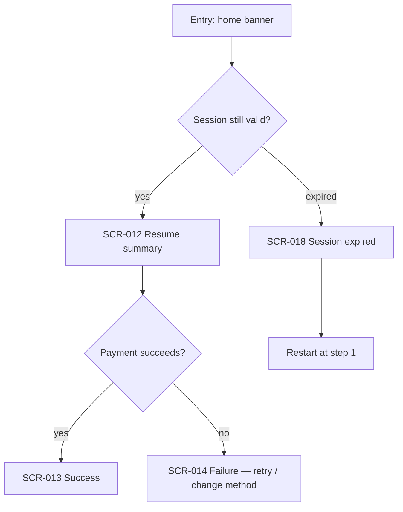

# UX artifacts

User stories, user flows, and screen specs — the "why" layer every interactive design traces
to. Written before pixels, updated with them.

## Contents

- When these are required
- Personas
- User stories
- User flows
- Screen specs
- Traceability
- Questions to ask per stage

## When these are required

Required for anything a user moves through: a screen, a flow, a feature, a form, a funnel.
Not required for a standalone logo, a colour ramp, or a one-off banner — those trace to the
brand, not to a story. When in doubt: if the design has states, it needs a story.

## Personas

`ux/personas.md`. Two to four, no more. Each: name/role, context of use (device,
environment, emotional state, time pressure), goal, what they do today instead, and the one
thing that makes them abandon. Skip demographics that change no decision. A persona that has
never killed a design idea is decoration.

## User stories

`ux/stories.md` — one table, append-only, IDs never reused.

```markdown
| ID | Story | Acceptance criteria | Flow | Priority |
| --- | --- | --- | --- | --- |
| US-014 | As a returning user, I want to resume an interrupted top-up so I don't re-enter card details | • resume banner appears within 24h<br>• one tap returns to the exact step<br>• expired sessions explain why and restart cleanly | FLOW-003 | must |
```

Acceptance criteria are observable and testable. "Is intuitive" is not a criterion; "completes
in ≤3 taps with no instruction" is. Each story names the flow it belongs to.

## User flows

`ux/flows/FLOW-###-<slug>.md`. One goal per flow — a flow that serves two goals should be two
flows.

~~~markdown
# FLOW-003 — Resume interrupted top-up

**Goal:** <the user's goal, in their words>
**Entry points:** push notification · home banner · deep link
**Success:** <the end state that means "done">
**Stories:** US-014, US-021

## Diagram



## Decision points
| # | Question | Branches | Who/what decides |

## Failure branches
| Failure | User sees | Recovery |

## Screens
SCR-012, SCR-013, SCR-014, SCR-018
~~~

Rules: map the **failure branches**, not just the happy path — most design defects live
there. Every node that is a screen carries its `SCR-###` ID. Keep the diagram under ~15
nodes; deeper detail belongs in a sub-flow.

## Screen specs

`ux/screens/SCR-###-<slug>.md`. The contract an implementer reads.

```markdown
# SCR-012 — Resume summary

**Purpose:** <one sentence>
**Flows:** FLOW-003 · **Stories:** US-014
**Prototype:** /screens/scr-012-resume-summary
**Platforms:** ios, android, web

## States
| State | Trigger | What the user sees |
| default | … | … |
| loading | … | skeleton for the summary card |
| empty | … | … |
| error | network/payment failure | inline error + retry, card details preserved |
| offline | … | … |
| no-permission | … | … |

## Anatomy
<component tree using UI-kit names: AppBar / SummaryCard / ButtonPrimary …>

## Content
<real copy, with max lengths; the longest realistic string, not lorem>

## Behaviour
<interactions, transitions and their motion tokens, what persists on back/kill>

## Accessibility
<focus order, labels, announcements, touch targets, contrast notes>

## Platform divergence
<what is intentionally native per platform — so an agent does not "fix" it>
```

**A screen without loading / empty / error states is not specified.** That is the single most
common gap, and the one that costs the most at implementation time.

## Traceability

`US-###` → `FLOW-###` → `SCR-###` → prototype route → implementation ticket. The IDs appear
in all five places. When a design changes, the trace is how you find everything that must
change with it — and it is how a coding agent knows which spec governs the file it is editing.

## Questions to ask per stage

Use these in Phase 2 (clarify) and Phase 5 (verify) rather than inventing questions:

- **Discovery** — Who is this for, and what do we *know* vs assume? What do they do today
  instead? What is the context of use — device, environment, emotional state, time pressure?
- **Ideation** — Does this address the real goal or a symptom? Are we designing past the
  happy path? What assumption is baked in that is still untested? What new friction does this
  add? Does it work for different abilities, devices, familiarity levels?
- **Prototype/test** — Can the user finish without instruction? Where do they hesitate or
  backtrack? Did they read it the way we intended?
- **Evaluate** — Are they completing the core task? Where do they drop off? Has the need
  shifted since we shipped? What is the next most important thing to improve?
